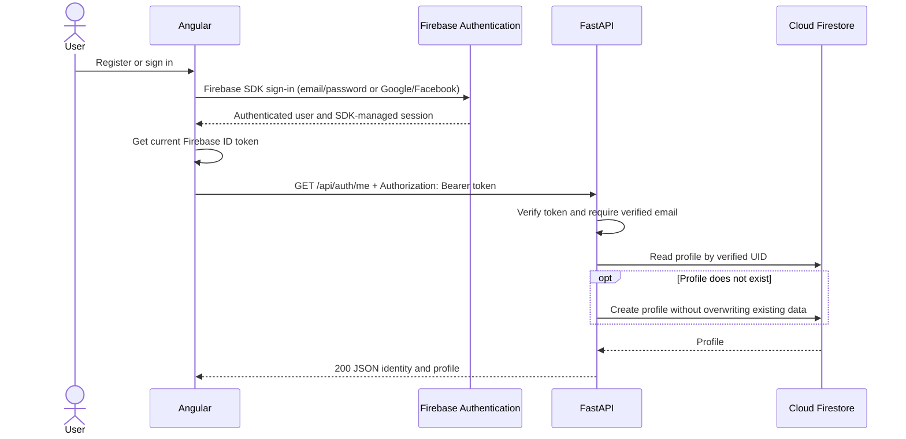

# Authentication integration and backend developer guide

This guide describes the **current local implementation** shared by Angular and
FastAPI. Backend developers can reuse the dependencies and services in section 7
when adding features. The default API base URL is `http://localhost:8000/api`.
Interactive API documentation is available at `http://localhost:8000/docs`.

## 1. Architecture



| Component | Responsibility |
| --- | --- |
| Angular | Sign-in forms, Firebase SDK session, attaching ID tokens and displaying API results. |
| Firebase Authentication | Accounts, provider sign-in and issuing authentication tokens. |
| FastAPI | Token verification, access checks and identifying the caller from the verified UID. |
| Cloud Firestore | Application profiles in `users/{uid}`. Accessed by the backend in this flow. |

Firebase Authentication can sign users in without Firestore. **The current `/me`
endpoint also reads a profile, so it requires a working Firestore database.**
The Angular route guard controls navigation; the backend independently checks API access.

## 2. Registration, login and session

| Method | Current flow |
| --- | --- |
| Email/password registration | `createUserWithEmailAndPassword()` creates the Auth account, then `sendEmailVerification()` sends the confirmation email. Angular opens `/auth/account-activation`. |
| Email/password login | `signInWithEmailAndPassword()` signs in. Verified users go to `/dashboard`; others go to account activation. |
| Google | `signInWithPopup()` with `GoogleAuthProvider`. The same operation is used by the register and login buttons. |
| Facebook | `signInWithPopup()` with `FacebookAuthProvider`. The same operation is used by the register and login buttons. |

For Google/Facebook, a first successful sign-in creates the Firebase Auth account.
All current sign-in paths check `user.emailVerified` before opening the dashboard.
A provider account without a verified email therefore cannot access `/me` under
the current policy.

The activation page reloads the Firebase user while visible and on focus. When
verification is detected, it refreshes token claims, signs out, and returns to
`/auth/login?verified=1`. The user then signs in again.

`FirebaseAuthService.getIdToken()` waits for restored auth state and calls
`user.getIdToken()`. The Firebase SDK manages session persistence and token
refresh; the application does not manually store tokens. The navbar's logout
calls Firebase `signOut()` and redirects to login. This does not revoke a token
already copied into another tool.

**Profile timing:** the dashboard calls `/api/auth/me`. That endpoint creates a
missing profile after token and email checks. Registration alone does not create
a Firestore document.

## 3. Request headers and Angular integration

Send a **Firebase ID token**, obtained from the Firebase SDK. A UID, Google/Facebook
access token, refresh token or Firebase web API key is not the API credential.

```http
GET /api/auth/me HTTP/1.1
Host: localhost:8000
Authorization: Bearer <Firebase-ID-token>
Accept: application/json
```

`Authorization` is required. `Accept` is optional. This GET request has no body
and does not require a request `Content-Type`. Use HTTPS for deployed APIs.
Do not put the token in query parameters or logs.

The existing `authInterceptor` is registered in `app.config.ts`. It obtains the
current token and sets this header:

```typescript
request.clone({ setHeaders: { Authorization: `Bearer ${token}` } });
```

It attaches tokens only when the request matches the configured API origin and
base path. With no signed-in user, it sends the request without the header; a
protected endpoint then rejects it. Components should use `HttpClient` through
the existing `CurrentUserService`, rather than build headers themselves:

```typescript
// Existing CurrentUserService method; the interceptor supplies Authorization.
getMe() {
  return this.http.get<CurrentUser>(`${environment.apiUrl}/auth/me`);
}
```

Angular calls `${environment.apiUrl}/auth/me`; `API_URL` already includes `/api`.
There are no FastAPI login, registration or refresh endpoints in this implementation.
Those operations use Firebase directly.

## 4. Backend verification and user identification

1. `HTTPBearer(auto_error=False)` extracts the credential from `Authorization`.
2. `get_current_user` rejects a missing credential and delegates to `AuthService`.
3. The Admin SDK performs verification:

   ```python
   claims = auth.verify_id_token(token, check_revoked=True)
   ```

   This checks the signature, expiry and Firebase project claims, plus revocation
   and account status. Reading a JWT payload alone is not verification.
4. `AuthenticatedUser` validates the selected claims. The verified `uid` identifies
   the caller; the backend never accepts a caller-supplied UID as proof of identity.
5. `/me` uses `get_verified_user`, which requires `email_verified=True`.
6. `UserService` reads `users/{uid}`. If absent, it atomically creates a document
   containing a server-generated `created_at` timestamp. Concurrent creation is
   handled without replacing an existing document.

Firebase Admin access bypasses Firestore Security Rules, so UID ownership is
enforced by backend code. Direct browser access to private profiles should be denied.
`/api/health` is public and does not require a token.

## 5. GET /api/auth/me: response contract

### Success: 200 OK

The JSON response uses these exact field names:

```json
{
  "uid": "firebase-user-123",
  "email": "learner@example.test",
  "email_verified": true,
  "display_name": "Learner",
  "profile": {
    "created_at": "2026-11-13T12:00:00Z"
  }
}
```

| Field | JSON type | Meaning |
| --- | --- | --- |
| `uid` | string | Stable Firebase UID from the verified token. |
| `email` | string or null | Email from the verified token, if present. |
| `email_verified` | boolean | Always `true` for a successful `/me` response under the current policy. |
| `display_name` | string or null | Firebase token's `name` claim, if present. |
| `profile` | object | Profile selected using the verified UID. |
| `profile.created_at` | date-time string or null | Creation timestamp; nullable for existing profiles without one. |

All listed fields are returned. Additional Firestore document fields are not
automatically exposed. A successful response includes `Cache-Control: no-store`.
The endpoint does not return tokens, passwords, credits or learning progress.

### Errors

Application errors use a JSON object with a string `detail`:

```json
{ "detail": "Authentication required or credentials invalid" }
```

| HTTP status | Exact `detail` value | Meaning and frontend action |
| --- | --- | --- |
| `401` | `Authentication required or credentials invalid` | Missing/wrong Bearer header; invalid, expired or revoked token; disabled/deleted account; or rejected identity claims. Ask the user to sign in again. Includes `WWW-Authenticate: Bearer`. |
| `403` | `Email verification required` | Token accepted, but email is unverified. Direct the user to account activation. |
| `503` | `Authentication service unavailable` | Firebase Auth is uninitialized or verification infrastructure failed. Show a service error and allow retry. |
| `503` | `User profile service unavailable` | Profile access or profile-data validation failed. Show a service error and allow retry. |
| `503` | `Firebase is not initialized` | Firestore initialization dependency is unavailable. Check backend configuration. |

Use HTTP status for frontend control flow and read `error.error.detail` for the
API message. These are API errors; Firebase SDK sign-in errors are handled
separately by `firebaseErrorMessage()`. A `503` must not be presented as a wrong password.

## 6. Configuration and private credentials

### Angular: frontend/.env

Copy `frontend/.env.example` to `frontend/.env` and fill the web configuration
from Firebase Console → Project settings → Your apps:

```dotenv
API_URL=http://localhost:8000/api
FIREBASE_API_KEY=<web-api-key>
FIREBASE_AUTH_DOMAIN=edukasyno.firebaseapp.com
FIREBASE_PROJECT_ID=edukasyno
FIREBASE_APP_ID=<web-app-id>
```

`generate-env.mjs` generates the ignored `environment.config.ts` before
`npm start`, `npm run build`, `npm run watch` and `npm test`. The committed
`environment.ts` and `environment.development.ts` import it. Restart the dev
server after changing `.env`. Process environment variables override the file.
When running `npx ng` directly, first run `npm run config`.

These values are public browser configuration, not private Admin credentials.
Blank example settings allow CI compilation/tests but do not enable real login.

### FastAPI: backend/.env

Copy `backend/.env.example` to `backend/.env`. Authentication-related settings:

```dotenv
API_PREFIX=/api
CORS_ORIGINS=["http://localhost:4200","http://127.0.0.1:4200"]
FIREBASE_CREDENTIALS_PATH=credentials/firebase-service-account.json
FIREBASE_PROJECT_ID=edukasyno
```

#### Install the local backend credential file

Why these files are needed:

- `backend/.env` tells FastAPI which Firebase project to use and where to find
  its credential file. `.env.example` is the shared template for these settings.
- `backend/credentials/` keeps private backend credentials in one Git-ignored folder.
- `firebase-service-account.json` contains the backend's service-account identity
  and private key. The current setup uses it to authenticate Firebase Admin calls,
  including account/revocation checks and Firestore profile access. It is separate
  from the user's Bearer token and must never be sent to Angular.

1. Open the same Firebase project used by Angular: **Project settings → Service
   accounts → Firebase Admin SDK**.
2. If you do not already have an approved service-account key for development,
   select **Generate new private key** and download the JSON file. You need
   permission to create service-account keys; otherwise ask the project owner
   for an approved development access method. Do not create a new key on every run.
3. Create `backend/credentials/` if needed. Move the downloaded JSON there and
   rename it to `firebase-service-account.json`:

   ```text
   backend/
   ├── .env
   └── credentials/
       └── firebase-service-account.json
   ```

4. Set `FIREBASE_CREDENTIALS_PATH` and `FIREBASE_PROJECT_ID` in `backend/.env`
   as shown above. The path is relative to `backend/` unless absolute.
5. Restart the backend. Check `GET /api/health`: `firebase_initialized: true`
   confirms Admin SDK initialization. It does **not** prove Firestore permissions
   or a real user-token/profile request works; check those through `/api/auth/me`.

`backend/.env` and `backend/credentials/` are ignored by Git. Never commit, paste
into an issue, or send this private JSON to the frontend. The startup script can
create `.env` from its example, but it cannot download Firebase credentials for you.
The frontend and backend must point to the same Firebase project.
For deployment, configure the actual HTTPS frontend origin in CORS and the API
URL used by Angular.

| Configuration | Where it belongs | Private? |
| --- | --- | --- |
| Firebase web API key, auth domain, project ID and web app ID | Angular web configuration | No; included in the browser bundle. Apply appropriate API restrictions. |
| Firebase Admin service-account JSON/private key | Backend only | **Yes. Never place it in Angular or commit it.** |
| Facebook App Secret | Facebook/Firebase provider configuration | **Yes. Never include it in the frontend `.env`.** |
| ID and refresh tokens | Firebase SDK session; ID token in API Authorization header | **Yes. Do not share, log or commit them.** |

In Firebase Console, enable the intended Authentication providers and authorize
`localhost` and the deployed frontend domain. Google requires its provider setup;
Facebook requires the App ID/Secret and Firebase OAuth redirect URL configured
in the Facebook app. Configure verification/reset emails for email/password.
Create Firestore and grant the backend service account appropriate access for `/me`.

## 7. Backend developer guide: adding a feature

### What a protected endpoint receives

The browser sends an HTTP request with a Bearer header. Your endpoint receives
an **`AuthenticatedUser` Python object** from a dependency, after verification.
It does not need to parse the token or call `/api/auth/me` itself.

```text
HTTP request + Authorization header
  → get_current_user: verify token and build AuthenticatedUser
  → get_verified_user: require verified email, if selected
  → your route: receive user.uid and the validated request data
  → your service: apply feature rules and access this user's data
  → response_model: serialize the result as JSON
```

The identity object has these attributes:

```python
user.uid             # str: use this to identify the owner
user.email           # str | None
user.email_verified  # bool
user.display_name    # str | None
```

The object contains no password, raw token, Firestore document, balance or game
progress. Those require their own service/data model. The UID identifies the
user across requests; no separate backend session table is currently used.

### Reuse the existing dependencies

| Use | What your endpoint gets |
| --- | --- |
| `Depends(get_current_user)` | Verified identity. Email confirmation is not required. |
| `Depends(get_verified_user)` | The same identity, plus an email-confirmation check. This is the policy used by `/me`. |
| `Depends(get_user_service)` | Existing profile service backed by Firestore. Does not authenticate the request by itself. |

Use a dependency on **each protected route**. Adding a route to the application
does not automatically protect it. Do not repeat `verify_id_token()` in routes.
The existing synchronous dependencies run blocking SDK work in FastAPI's thread
pool. Keep synchronous Firestore service calls in synchronous routes, following
the current `/me` pattern.

### Example: a new endpoint using identity only

**Example only — `/api/identity` is not an implemented endpoint.** This shows a
complete route pattern to adapt when adding your own feature:

```python
# Example: backend/src/routes/identity.py
from fastapi import APIRouter, Depends

from src.dependencies import get_verified_user
from src.models.auth import AuthenticatedUser

router = APIRouter(prefix="/identity", tags=["identity"])


@router.get("", response_model=AuthenticatedUser)
def read_identity(
    user: AuthenticatedUser = Depends(get_verified_user),
) -> AuthenticatedUser:
    return user
```

Import the new route module in `src/main.py`, then register its router inside
the existing `create_app()` function, before `return app`:

```python
# Module import:
from src.routes import identity

# Inside create_app(), alongside the existing include_router() calls:
app.include_router(identity.router, prefix=settings.api_prefix)
```

For a valid verified user, this example would return `200` with:

```json
{
  "uid": "firebase-user-123",
  "email": "learner@example.test",
  "email_verified": true,
  "display_name": "Learner"
}
```

This example needs Firebase Authentication but performs no Firestore access.
Its dependency supplies the same `401`, `403` and authentication `503` errors
documented above; the shared application error handler formats them.

### When the feature needs a profile or other stored data

For an existing profile, follow the actual route in
[`backend/src/routes/auth.py`](../../backend/src/routes/auth.py): inject both
`get_verified_user` and `get_user_service`, then call
`service.get_current_user(user)`. It returns a `CurrentUserResponse` Python
object, which FastAPI serializes into the `/me` JSON shown in section 5.
This call can also provision a missing profile; it does not return arbitrary
Firestore fields.

For a new feature such as learning progress:

1. Define its request and response Pydantic models in `src/models/`.
2. Put its business logic and Firestore operations in a service in `src/services/`.
   `get_firestore()` in `firebase_service.py` supplies the initialized client;
   `get_user_service()` is the existing dependency-construction example.
3. Pass `user.uid` from the auth dependency into that service. Do not accept an
   owner UID from the request body as authentication. Follow `UserService`'s UID
   checks before using an identity as a Firestore document ID.
4. Validate the requested action on the server. For example, calculate earned
   credits from a validated answer rather than trusting a client-supplied reward.
5. Return a declared response model containing only fields intended for Angular.
   Adding fields to Firestore does not add them to the API response automatically.

Use the shared `AppError` subclasses for their documented cases. If your feature
needs a new domain error, define its status and safe message in
`src/utils/exceptions.py`; the existing handler returns `{"detail": "..."}`.
Do not translate a database outage into `401` or expose raw SDK exceptions.

### Checks before handing a new endpoint to Angular

- Test a valid user, missing/expired token, and unverified email when required.
- Verify that one user cannot select another user's data through request fields.
- Test the JSON schema and database failures. Existing examples are in
  [`backend/tests/test_auth.py`](../../backend/tests/test_auth.py), with Firebase
  verification and Firestore mocked.
- Give frontend developers the method/path, request model, response model and
  possible status codes. Their existing interceptor supplies the Bearer header
  for requests under the configured API URL.

## 8. Implementation status and integration check

**Implemented:** provider/email sign-in, verification flow, SDK session integration,
logout, API interceptor, backend token checks, `/me`, UID-linked profile provisioning,
and automated tests using mocked Firebase Auth/Firestore.

**Pending or outside this change:** immediate profile creation at registration,
provider account linking, API rate limiting/complete abuse-control verification,
and saving game results, credits and learning progress. Real project/provider
configuration and a successful live profile request must be verified separately;
mocked tests do not establish those are working.

To check integration locally:

1. Start both servers with `bash scripts/start-dev.sh` from the real repository
   directory (for this machine, `~/Documents/kasyno-edu`).
2. Sign in and complete email verification if required. Open `/dashboard`.
3. In browser Network tools, check that `/api/auth/me` has the Bearer header and
   returns the documented `200` response. Keep the token private.
4. Confirm Firestore contains `users/{response.uid}`. Repeat the request and
   confirm the existing profile is preserved.
5. Request `/api/auth/me` without authorization and expect `401`.

