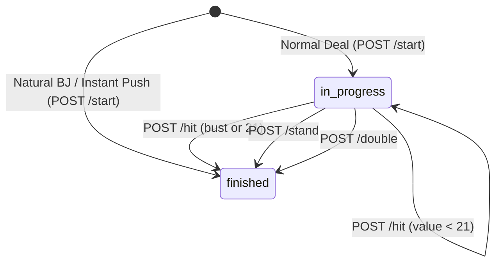

# Classic Blackjack API

Guide for frontend developers integrating the **Classic Blackjack** view with the FastAPI backend.
The API base URL is `http://localhost:8000/api` (configured in Angular as `environment.apiUrl`). Interactive OpenAPI docs are available at `http://localhost:8000/docs`.

---

## 1. Overview & Authentication

Unlike Ruleta and Sloty, Blackjack is **stateful** across multiple player actions (`start` → `hit` / `stand` / `double`).
To keep outcomes tamper-proof:

- The shoe (`BLACKJACK_DECK_COUNT` standard 52-card decks, shuffled with `secrets.randbelow`) and the dealer's hole card stay strictly on the server until the round finishes.
- The initial wager is deducted upfront (escrow) on `POST /start` (and doubled on `POST /double`) inside atomic Firestore transactions, so abandoning a hand cannot avoid a loss.
- Every endpoint requires a verified Firebase user (`Authorization: Bearer <Firebase-ID-token>`, attached automatically in Angular by `authInterceptor`) and returns `Cache-Control: no-store`.

### House Rules (Fixed)

- **Shoe**: Freshly shuffled 6-deck shoe per round by default (`BLACKJACK_DECK_COUNT`).
- **Dealer rule (S17)**: Dealer stands on **all 17s** (both hard 17 and soft 17).
- **Natural Blackjack**: Checked immediately on the initial 2-card deal (`player_blackjack` pays **3:2**, i.e., `total_payout = (bet * 5) // 2` floored to integer credits; mutual Blackjack is a `push`).
- **Standard Win / Dealer Bust**: Pays **1:1** (`total_payout = bet * 2`).
- **Push (Tie)**: Stake returned (`total_payout = bet`).
- **Player Actions**: `hit`, `stand`, and `double` (allowed only on the initial 2-card hand). Hitting to exactly `21` automatically triggers the dealer's turn.

### Round Lifecycle



---

## 2. Endpoints (`/api/games/blackjack/*`)

| Method & Path | Status | Purpose |
| --- | --- | --- |
| `POST /api/games/blackjack/start` | `201` | Start a new round, deduct `bet_amount`, deal cards, and resolve natural Blackjack if dealt. |
| `GET /api/games/blackjack/{game_id}` | `200` | Fetch current round state (useful to recover an active hand after a page refresh). |
| `POST /api/games/blackjack/{game_id}/hit` | `200` | Draw 1 card. Auto-finishes on bust (`> 21`) or auto-stands on `21`. |
| `POST /api/games/blackjack/{game_id}/stand` | `200` | Reveal dealer hole card, draw dealer to `>= 17`, and settle payout. |
| `POST /api/games/blackjack/{game_id}/double` | `200` | Available only on 2 cards: deduct matching `bet_amount`, draw 1 card, and finish round. |

### `POST /api/games/blackjack/start` Request Body

```json
{
  "bet_amount": 25
}
```

| Field | Type | Required | Rules |
| --- | --- | --- | --- |
| `bet_amount` | strict integer | Yes | JSON integer (no floats, booleans, or strings) within `[BLACKJACK_MIN_BET_AMOUNT, BLACKJACK_MAX_BET_AMOUNT]` (default `1`–`1000`). Extra fields are rejected (`422`). |

`GET /{game_id}`, `POST /{game_id}/hit`, `POST /{game_id}/stand`, and `POST /{game_id}/double` take no request body.

---

### Unified Response Schema (`BlackjackGameResponse`)

All 5 endpoints return the same shape:

| Field | Type | Meaning |
| --- | --- | --- |
| `game_id` | string (UUID) | Server-generated round identifier for `/hit`, `/stand`, `/double`, and `GET /{game_id}`. |
| `status` | `"in_progress" \| "finished"` | Current round state. |
| `outcome` | string \| `null` | `null` while `in_progress`. When `finished`, one of: `"player_blackjack"`, `"dealer_blackjack"`, `"player_win"`, `"dealer_win"`, `"player_bust"`, `"dealer_bust"`, `"push"`. |
| `bet_amount` | integer | Active wager (doubles if `POST /double` succeeds). |
| `payout` | integer | Total credits returned (`0` while `in_progress` or on loss). |
| `net_profit` | integer | `payout - bet_amount`. |
| `new_balance` | integer | Authoritative Firestore credit balance after the latest action. |
| `player_cards` | `Card[]` | List of `{ "rank": "2".."10"\|"J"\|"Q"\|"K"\|"A", "suit": "spades"\|"hearts"\|"diamonds"\|"clubs" }`. |
| `player_value` | integer | Best Blackjack total (`<= 21` if Aces can be reduced). |
| `player_is_soft` | boolean | `true` if an Ace is currently counted as `11`. |
| `dealer_cards` | `Card[]` | Only the 1 visible upcard while `in_progress`; full dealer hand when `finished`. |
| `dealer_value` | integer | Total of `dealer_cards` currently visible. |
| `dealer_hidden_cards` | integer | `1` while `in_progress` (render a card back in the UI), `0` when `finished`. |
| `available_actions` | `("hit" \| "stand" \| "double")[]` | Actions currently allowed (`[]` when `finished`). Drive button visibility/disabled states directly from this array. |

#### Example 1 — `POST /start` (`201 Created`, in progress)

```json
{
  "game_id": "3f9a1c5c-4c3f-4a7f-8a8e-52f8c9f72e11",
  "status": "in_progress",
  "outcome": null,
  "bet_amount": 25,
  "payout": 0,
  "net_profit": -25,
  "new_balance": 475,
  "player_cards": [
    { "rank": "6", "suit": "spades" },
    { "rank": "5", "suit": "hearts" }
  ],
  "player_value": 11,
  "player_is_soft": false,
  "dealer_cards": [
    { "rank": "10", "suit": "clubs" }
  ],
  "dealer_value": 10,
  "dealer_hidden_cards": 1,
  "available_actions": ["hit", "stand", "double"]
}
```

#### Example 2 — `POST /{game_id}/stand` (`200 OK`, finished win)

```json
{
  "game_id": "3f9a1c5c-4c3f-4a7f-8a8e-52f8c9f72e11",
  "status": "finished",
  "outcome": "player_win",
  "bet_amount": 25,
  "payout": 50,
  "net_profit": 25,
  "new_balance": 525,
  "player_cards": [
    { "rank": "6", "suit": "spades" },
    { "rank": "5", "suit": "hearts" },
    { "rank": "8", "suit": "diamonds" }
  ],
  "player_value": 19,
  "player_is_soft": false,
  "dealer_cards": [
    { "rank": "10", "suit": "clubs" },
    { "rank": "8", "suit": "spades" }
  ],
  "dealer_value": 18,
  "dealer_hidden_cards": 0,
  "available_actions": []
}
```

---

## 3. Error Responses

| HTTP Status | Example `detail` | Cause & Frontend Handling |
| --- | --- | --- |
| `400` | `"Insufficient credits"` | Balance is too low on `/start` or `/double`. Note: if `/double` returns `400`, the round stays `in_progress` and the player can still `hit` or `stand`. |
| `401` | `"Authentication required or credentials invalid"` | Missing, invalid, expired, or revoked Bearer token (`WWW-Authenticate: Bearer`). |
| `403` | `"Email verification required"` | Token valid, email unverified. |
| `404` | `"Blackjack game not found"` | Unknown `game_id`, expired session (`BLACKJACK_SESSION_TTL_SECONDS`), or belongs to another user. |
| `409` | `"An active Blackjack game already exists"` / `"Action is not allowed in the current game state"` | Exceeded `BLACKJACK_MAX_ACTIVE_GAMES_PER_USER`, round already finished, or `double` called after `hit`. |
| `422` | `"Bet amount must be at least 1"` / FastAPI validation array | Invalid types, extra fields, or bet outside `[BLACKJACK_MIN_BET_AMOUNT, BLACKJACK_MAX_BET_AMOUNT]`. |
| `503` | `"User profile service unavailable"` | Missing Firestore profile or backend/Firebase outage. |

---

## 4. Configurable Settings (`backend/.env`)

Defined in `backend/src/configs/games/blackjack.py` (`BlackjackSettings`, `env_prefix="BLACKJACK_"`):

| Env Variable | Default | Meaning |
| --- | --- | --- |
| `BLACKJACK_MIN_BET_AMOUNT` | `1` | Minimum wager per round |
| `BLACKJACK_MAX_BET_AMOUNT` | `1000` | Maximum initial wager per round |
| `BLACKJACK_DECK_COUNT` | `6` | Number of 52-card decks in the shoe (`1–8`) |
| `BLACKJACK_SESSION_TTL_SECONDS` | `1800` | In-memory round lifetime in seconds (minimum `60`) |
| `BLACKJACK_MAX_ACTIVE_GAMES_PER_USER` | `1` | Concurrent `in_progress` rounds allowed per user (`1–10`) |

---

## 5. Angular Integration Example

```typescript
import { HttpClient } from '@angular/common/http';
import { Injectable, inject } from '@angular/core';
import { Observable } from 'rxjs';

import { environment } from '../../environments/environment';

export type Suit = 'spades' | 'hearts' | 'diamonds' | 'clubs';
export type Rank = '2' | '3' | '4' | '5' | '6' | '7' | '8' | '9' | '10' | 'J' | 'Q' | 'K' | 'A';
export type BlackjackStatus = 'in_progress' | 'finished';
export type BlackjackAction = 'hit' | 'stand' | 'double';
export type BlackjackOutcome =
  | 'player_blackjack'
  | 'dealer_blackjack'
  | 'player_win'
  | 'dealer_win'
  | 'player_bust'
  | 'dealer_bust'
  | 'push';

export interface BlackjackCard {
  rank: Rank;
  suit: Suit;
}

export interface BlackjackGameResponse {
  game_id: string;
  status: BlackjackStatus;
  outcome: BlackjackOutcome | null;
  bet_amount: number;
  payout: number;
  net_profit: number;
  new_balance: number;
  player_cards: BlackjackCard[];
  player_value: number;
  player_is_soft: boolean;
  dealer_cards: BlackjackCard[];
  dealer_value: number;
  dealer_hidden_cards: number;
  available_actions: BlackjackAction[];
}

@Injectable({ providedIn: 'root' })
export class BlackjackService {
  private readonly http = inject(HttpClient);
  private readonly baseUrl = `${environment.apiUrl}/games/blackjack`;

  start(betAmount: number): Observable<BlackjackGameResponse> {
    return this.http.post<BlackjackGameResponse>(`${this.baseUrl}/start`, {
      bet_amount: betAmount,
    });
  }

  getGame(gameId: string): Observable<BlackjackGameResponse> {
    return this.http.get<BlackjackGameResponse>(`${this.baseUrl}/${gameId}`);
  }

  hit(gameId: string): Observable<BlackjackGameResponse> {
    return this.http.post<BlackjackGameResponse>(`${this.baseUrl}/${gameId}/hit`, {});
  }

  stand(gameId: string): Observable<BlackjackGameResponse> {
    return this.http.post<BlackjackGameResponse>(`${this.baseUrl}/${gameId}/stand`, {});
  }

  doubleDown(gameId: string): Observable<BlackjackGameResponse> {
    return this.http.post<BlackjackGameResponse>(`${this.baseUrl}/${gameId}/double`, {});
  }
}
```

### Frontend UI Flow Recommendations

1. **Drive action buttons from `available_actions`:** Enable Hit / Stand / Double strictly based on `response.available_actions` and disable all buttons while an HTTP request is in flight.
2. **Render dealer hole card safely:** When `dealer_hidden_cards > 0`, show `dealer_hidden_cards` face-down card backs next to `dealer_cards[0]`.
3. **Sync credits from `new_balance`:** Update the player's displayed balance from `response.new_balance` after every response (since `/start` and `/double` deduct immediately and `/stand` or `/hit` on `21` credits payouts).
4. **Optional refresh recovery:** Save `game_id` in component/session storage while `status === 'in_progress'` and call `getGame(gameId)` on reload (clearing it on `404` or when `status === 'finished'`).

---

## 6. Firestore Credits & Transaction Reasons

- Initial wager on `/start`: `-bet_amount` with reason `"Blackjack: zakład"`.
- Additional wager on `/double`: `-additional_bet` with reason `"Blackjack: podwojenie"`.
- Winning payout: `+payout` with reason `"Blackjack: wygrana"`.
- Push (tie) refund: `+payout` with reason `"Blackjack: zwrot"`.
- Natural Blackjack / instant push on `/start` executes bet and payout atomically in a single Firestore transaction (`UserService.settle_game_wager`).
