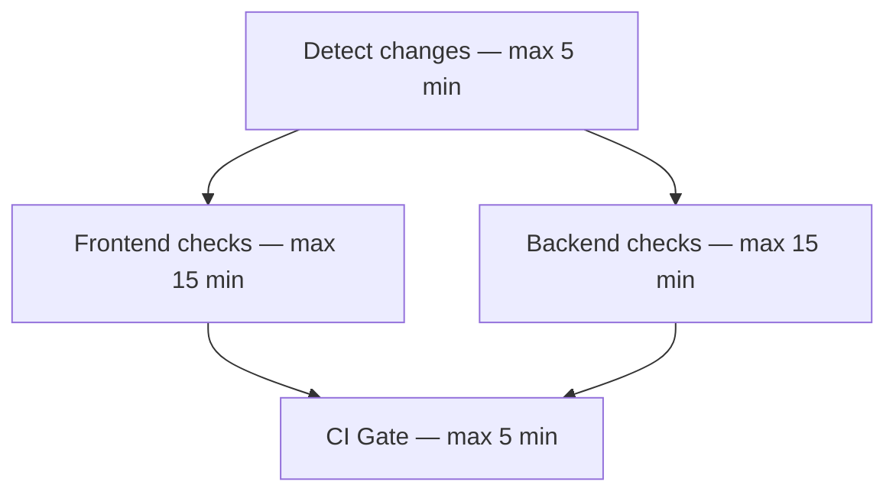

# CI overview

The [CI workflow](../../.github/workflows/ci.yml) runs only for pull requests targeting `main`: when opened, reopened, or updated with new commits. It checks code before merging and does not deploy the application.

## How it works

1. **Detect changes** checks which files were added, modified, or deleted in the PR.
2. **Frontend checks** run when anything in `frontend/` changes: install npm dependencies, check formatting with Prettier, run tests, and build Angular.
3. **Backend checks** run when anything in `backend/` changes: validate the Poetry configuration and lockfile, install dependencies, check Python syntax, and run pytest.
4. **CI Gate** waits for the results. It passes when change detection succeeds and both project jobs pass or are intentionally skipped. Failures and cancellations make it fail.

If only files outside those folders change, such as `docs/` or `ci.yml`, both project jobs are skipped. Backend checks require the Python project files when triggered.

## Timing and results

Frontend and backend jobs can run in parallel on separate Ubuntu runners. Each timeout applies only to its own job. If backend takes 10 minutes, CI Gate waits and then starts its own 5-minute timer. Exceeding the backend's 15-minute limit causes a failure.

Pushing a new commit to the same PR cancels its older workflow run.

Require **CI Gate** in branch protection. To find an error, open the PR's **Checks** tab and inspect the failed job's logs.
